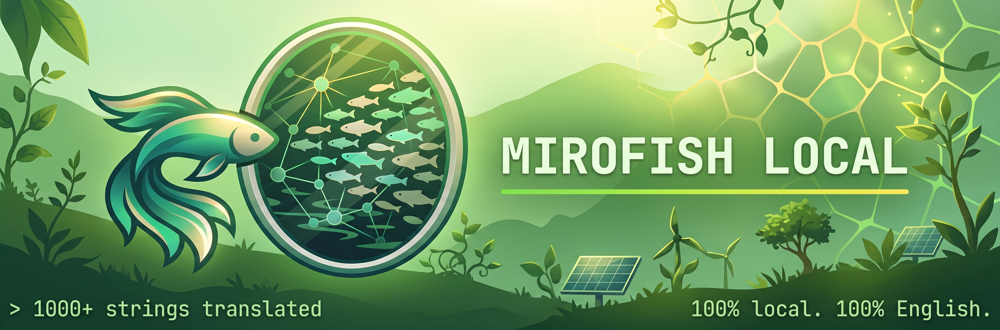
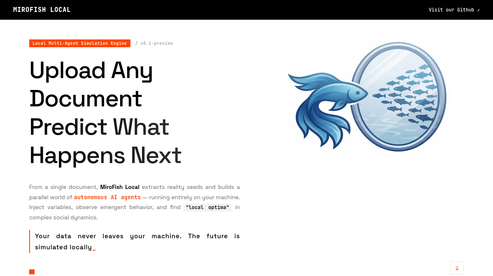

<div align="center">



# MiroFish-Local

**Local-first multi-agent simulation engine. Forked from [MiroFish-Offline](https://github.com/nikmcfly/MiroFish-Offline) (based on [666ghj/MiroFish](https://github.com/666ghj/MiroFish)) — Full English UI, Neo4j & multi-provider support.**

*A multi-agent swarm intelligence engine that simulates public opinion, market sentiment, and social dynamics. Entirely on your hardware.*

[](https://github.com/kodokbakar/MiroFish-Local/stargazers)
[](https://github.com/kodokbakar/MiroFish-Local/network)
[](https://hub.docker.com/)
[](./LICENSE)

</div>

## What is this?

MiroFish is a multi-agent simulation engine: upload any document (press release, policy draft, financial report), and it generates hundreds of AI agents with unique personalities that simulate the public reaction on social media. Posts, arguments, opinion shifts — hour by hour.

The [original MiroFish](https://github.com/666ghj/MiroFish) was built for the Chinese market with hard vendor lock-in (Chinese UI, Zep Cloud for graph storage, DashScope API). Forked from [MiroFish-Offline](https://github.com/nikmcfly/MiroFish-Offline), this project provides a **full English interface, local Neo4j graph memory, and flexible multi-provider LLM support**:

| Original MiroFish | MiroFish-Local |
|---|---|
| Chinese UI | **English UI** (1,000+ strings translated) |
| Zep Cloud (graph memory) | **Neo4j Community Edition 5.18+** |
| DashScope / OpenAI API (LLM) | **Ollama / Gemini / DeepSeek / Any OpenAI-compatible API** |
| Zep Cloud embeddings | **Ollama (nomic-embed-text)**, **Gemini API**, or **OpenAI API** |
| Mandatory cloud dependencies | **Zero cloud lock-in (100% self-hosted & offline-capable, or BYOK APIs)** |

## Workflow

1. **Graph Build** — Extracts entities (people, companies, events) and relationships from your document. Builds a knowledge graph with individual and group memory via Neo4j.
2. **Env Setup** — Generates hundreds of agent personas, each with unique personality, opinion bias, reaction speed, influence level, and memory of past events.
3. **Simulation** — Agents interact on simulated social platforms: posting, replying, arguing, shifting opinions. The system tracks sentiment evolution, topic propagation, and influence dynamics in real time.
4. **Report** — A ReportAgent analyzes the post-simulation environment, interviews a focus group of agents, searches the knowledge graph for evidence, and generates a structured analysis.
5. **Interaction** — Chat with any agent from the simulated world. Ask them why they posted what they posted. Full memory and personality persists.

## Screenshot

<div align="center">

</div>

## Quick Start

### Prerequisites

- Docker & Docker Compose (recommended), **or**
- Python 3.11 or 3.12 (Python 3.13+ is not supported due to camel-oasis dependencies), Node.js 18+, Neo4j 5.18+, Ollama

### Option A: Docker (easiest)

```bash
git clone https://github.com/kodokbakar/MiroFish-Local.git
cd MiroFish-Local
cp .env.example .env

# Start all services (Neo4j, Ollama, MiroFish)
docker compose up -d

# Pull the required models into Ollama
docker exec mirofish-ollama ollama pull qwen2.5:32b
docker exec mirofish-ollama ollama pull nomic-embed-text
```

Open `http://localhost:3000` — that's it.

### Option B: Manual

**1. Start Neo4j**

```bash
docker run -d --name neo4j \
  -p 7474:7474 -p 7687:7687 \
  -e NEO4J_AUTH=neo4j/mirofish \
  neo4j:5.18-community
```

**2. Start Ollama & pull models**

```bash
ollama serve &
ollama pull qwen2.5:32b      # LLM (or qwen2.5:14b for less VRAM)
ollama pull nomic-embed-text  # Embeddings (768d)
```

**3. Configure & run backend**

```bash
cp .env.example .env
# Edit .env if your Neo4j/Ollama are on non-default ports

cd backend
# Using uv (recommended):
uv sync
uv run python run.py

# Or using standard pip:
pip install -r requirements.txt
python run.py

**4. Run frontend**

```bash
cd frontend
npm install
npm run dev
```

Open `http://localhost:3000`.

## Configuration

All settings are in `.env` (copy from `.env.example`):

```bash
# Main LLM — OpenAI-compatible API (DeepSeek, OpenAI, Ollama, etc.)
LLM_API_KEY=your_api_key_or_ollama
LLM_BASE_URL=https://api.deepseek.com   # or http://localhost:11434/v1
LLM_MODEL_NAME=deepseek-flash          # or qwen2.5:32b

# OASIS / CAMEL
OPENAI_API_KEY=your_api_key_or_ollama
OPENAI_API_BASE_URL=https://api.deepseek.com

# Embeddings (provider: 'ollama', 'gemini', or 'openai')
EMBEDDING_PROVIDER=ollama              # or 'gemini', 'openai'
EMBEDDING_MODEL=nomic-embed-text       # or gemini-embedding-2, text-embedding-3-small
EMBEDDING_DIMENSIONS=768
EMBEDDING_BASE_URL=http://localhost:11434

# Required only if provider is 'gemini':
# GEMINI_API_KEY=your_gemini_api_key

# Required only if provider is 'openai':
# EMBEDDING_API_KEY=your_api_key
# Neo4j
NEO4J_URI=bolt://localhost:7687
NEO4J_USER=neo4j
NEO4J_PASSWORD=mirofish
```

Works with local Ollama out of the box, or with Google Gemini and any OpenAI-compatible API (DeepSeek, OpenAI, Claude via proxy, vLLM).
## Architecture

This fork introduces a clean abstraction layer between the application and the graph database:

```
┌─────────────────────────────────────────┐
│              Flask API                   │
│  graph.py  simulation.py  report.py     │
└──────────────┬──────────────────────────┘
               │ app.extensions['neo4j_storage']
┌──────────────▼──────────────────────────┐
│           Service Layer                  │
│  EntityReader  GraphToolsService         │
│  GraphMemoryUpdater  ReportAgent         │
└──────────────┬──────────────────────────┘
               │ storage: GraphStorage
┌──────────────▼──────────────────────────┐
│         GraphStorage (abstract)          │
│              │                            │
│    ┌─────────▼─────────┐                │
│    │   Neo4jStorage     │                │
│    │  ┌───────────────┐ │                │
│    │  │ EmbeddingService│ ← Ollama / Gemini / OpenAI │
│    │  │ NERExtractor   │ ← Ollama LLM   │
│    │  │ SearchService  │ ← Hybrid search │
│    │  └───────────────┘ │                │
│    └───────────────────┘                │
└─────────────────────────────────────────┘
               │
        ┌──────▼──────┐
        │  Neo4j CE   │
        │  5.18+      │
        └─────────────┘
```

**Key design decisions:**

- `GraphStorage` is an abstract interface — swap Neo4j for any other graph DB by implementing one class
- Dependency injection via Flask `app.extensions` — no global singletons
- Hybrid search: 0.7 × vector similarity + 0.3 × BM25 keyword search
- Synchronous NER/RE extraction via local LLM (replaces Zep's async episodes)
- All original dataclasses and LLM tools (InsightForge, Panorama, Agent Interviews) preserved

## Hardware Requirements

| Component | Minimum | Recommended |
|---|---|---|
| RAM | 16 GB | 32 GB |
| VRAM (GPU) | 10 GB (14b model) | 24 GB (32b model) |
| Disk | 20 GB | 50 GB |
| CPU | 4 cores | 8+ cores |

CPU-only mode works but is significantly slower for LLM inference. For lighter setups, use `qwen2.5:14b` or `qwen2.5:7b`.

## Use Cases

- **PR crisis testing** — simulate the public reaction to a press release before publishing
- **Trading signal generation** — feed financial news and observe simulated market sentiment
- **Policy impact analysis** — test draft regulations against simulated public response
- **Creative experiments** — someone fed it a classical Chinese novel with a lost ending; the agents wrote a narratively consistent conclusion

## License

AGPL-3.0 — same as the original MiroFish project. See [LICENSE](./LICENSE).

## Credits & Attribution

This is a modified fork of [MiroFish](https://github.com/666ghj/MiroFish) by [666ghj](https://github.com/666ghj), originally supported by [Shanda Group](https://www.shanda.com/). The simulation engine is powered by [OASIS](https://github.com/camel-ai/oasis) from the CAMEL-AI team.

**Lineage & Modifications:**
- Forked from [nikmcfly/MiroFish-Offline](https://github.com/nikmcfly/MiroFish-Offline), which migrated the backend from Zep Cloud to Neo4j + Ollama and translated the UI to English
- Maintained & rebranded as **MiroFish-Local** by [kodokbakar](https://github.com/kodokbakar)
